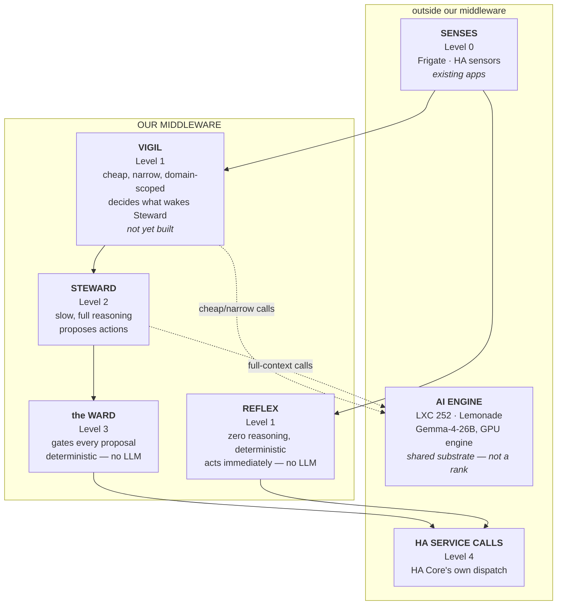
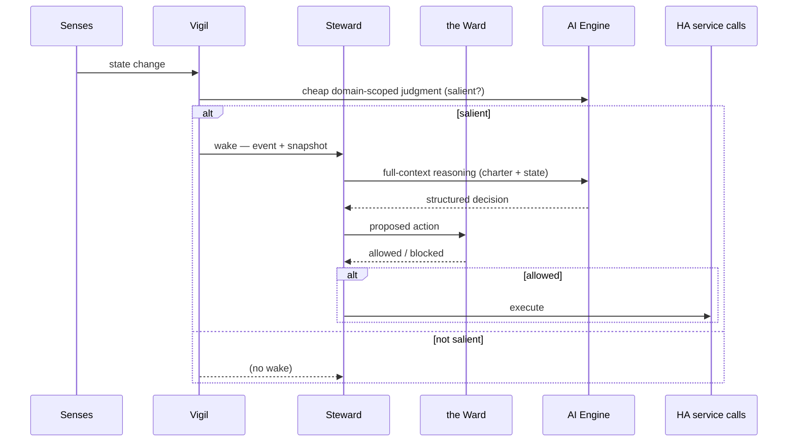
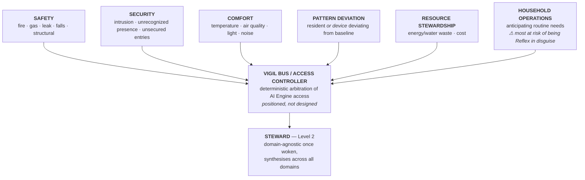

# Architecture — Abode AI Autonomy Steward

The full design specification, written for a person to read and understand in
one sitting. The numbered design rules are in [decisions](decisions/); the
original architecture theses and as-builts this is reconstructed from are in
[source/](source/).

---

## Executive summary

An autonomous home is **not a bigger rule engine**. It is a system that forms
judgment about situations it was never explicitly told how to handle — "could
it have handled a combination of circumstances nobody wrote a rule for?"
Everything in this architecture follows from that one bar.

The problem with a single reasoning loop is that judgment is expensive, and
most of what happens in a home is not worth judging. So the work is split
across **five components in four ranks**, with **six functional domains**
cross-cutting the two middle components:

- **Senses** (perception) feed two independent, parallel consumers.
- **Reflex** acts on the unambiguous cases instantly, with zero reasoning.
- **Vigil** judges the ambiguous cases cheaply, domain by domain, and decides
  *what is worth the expensive reasoner's attention*.
- **Steward** is the expensive reasoner — full-context judgment that proposes
  actions.
- **the Ward** is a deterministic gate that checks every proposal against the
  constitution before it executes.

The **AI Engine** (LXC 252, Lemonade) is infrastructure *supplied to* the
middleware, not a rank in it — Vigil and Steward call it, Reflex and the Ward
never do.

---

## The architecture at a glance

| Rank | Component | What it is | Built? |
| --- | --- | --- | --- |
| 0 | **Senses** | Perception substrate — Frigate, HA sensors. External, supplied to us. | existing apps |
| 1 | **Reflex** | Fast, deterministic, zero-reasoning automations. Acts directly, no LLM. | HA automations |
| 1 | **Vigil** | Cheap, narrow, **domain-scoped** salience — decides what wakes the Steward. | **not built** |
| 2 | **Steward** | Slow, full reasoning — the App. Proposes actions. | this repo |
| 3 | **the Ward** | The constraint layer — deterministic gate on every proposal. | `constraint_layer.py` |
| 4 | HA service calls | Actuation — HA Core's own dispatch, outside the middleware. | HA |

Reflex and Vigil sit at the **same rank**: both consume Senses directly, and
**neither feeds the other**. Reflex bypasses the Steward and the Ward
entirely; Vigil's only job is deciding what reaches the Steward.

### Full stack

### One wake-to-action pass

---

## The six functional domains

Domains **cross-cut Reflex and Vigil** — they are not Vigil's internal
structure, and neither owns them alone. Each domain has a **Reflex slice**
(discrete, unambiguous — no judgment) and a **Vigil slice** (ambiguous,
context-dependent — judgment required). What varies is *ambiguity*, not
subject matter: a leak sensor triggering is Reflex's Safety slice; a stopped
wash cycle that might be deliberate or a fault is Vigil's Pattern-deviation
slice.

| # | Domain | Vigil watches for | Notes |
| --- | --- | --- | --- |
| 1 | Safety | fire/smoke, gas, leak/flood, falls, structural | plausibly cheapest & highest priority |
| 2 | Security | intrusion, unrecognized lingering presence, unsecured entries | |
| 3 | Comfort | temperature, air quality, light, noise | |
| 4 | Pattern deviation | a resident *or a device* deviating from its baseline | needs history to judge against |
| 5 | Resource stewardship | energy/water waste, cost | |
| 6 | Household operations | anticipating routine needs | most likely to collapse into Reflex |

Domain 4 was **reframed** from "wellbeing/routine" (residents only) to
"pattern deviation" (residents *and* devices): a stopped washing machine and a
resident deviating from their routine require the *same* judgment shape —
noticing deviation from a baseline, then judging whether the deviation is
worth surfacing given context.

---

## The components, in detail

### Senses (Level 0)

Perception substrate — Frigate, HA sensors, later Tara. **External and
unowned**: supplied by existing applications, not ours to build or claim. It
sits outside the middleware boundary, symmetric with HA service calls.

### Reflex (Level 1)

Fast, deterministic, zero reasoning. Discrete, unambiguous state transitions
with a known-correct response — a leak sensor triggering, smoke detected, a
freezer door left open. No LLM call, no waiting on Vigil. Reflex acts directly
on Senses and reaches HA service calls while **bypassing the Steward and the
Ward entirely**.

### Vigil (Level 1)

The missing tier. **Cheap, narrow, domain-scoped salience** — several narrow
judgments (one per domain), not one generalist judge. Its only job is deciding
what wakes the Steward. It is **domain-scoped and multi-agent** for a concrete
reason: HA's own rejected multi-task-agent experiment failed on task-type
diversity in one agent, and one judge holding "is this dangerous / wasteful /
suspicious" in a single prompt is closer to that rejected shape than several
narrow domain judges would be.

A **Vigil bus / access controller** sits above the six domain functions,
arbitrating their shared access to the AI Engine. It is **deterministic, not a
judgment component** (the same category as the Ward) — arbitrating whose GPU
call goes first isn't a judgment about the house. It is positioned but not
designed, blocked on real per-domain call costs.

The **Reflex/Vigil boundary** is the reference case: Reflex handles a leak
sensor triggering (Safety, unambiguous); Vigil handles a stopped wash cycle
that could be deliberate (paused, forgotten, resident went out) or a fault
(Pattern deviation, context-dependent). A hard-coded threshold can't judge the
latter — that is the shape of problem domain-scoped judgment exists for.

### Steward (Level 2)

The expensive reasoner — the `abode_ai_autonomy_steward` App. Slow, full
reasoning over the complete state, proposes actions. **Domain-agnostic once
woken** — synthesis across domains is System 2's job. Its loop is a reactive
control loop: sense fresh, decide, act or propose, repeat — event-driven, not
scheduled.

### the Ward (Level 3)

The constraint layer (`constraint_layer.py`). A deterministic gate that checks
every proposal — including already-approved actions — against the constitution
the charter defines. **Domain-blind**: it gates by service/target/type, not by
which domain proposed the action.

### The AI Engine

LXC 252 (Lemonade, Gemma-4-26B, GPU engine) is **infrastructure supplied to
the middleware** — the same treatment as Senses, not a rank in the data flow.
Vigil and Steward both call it; Reflex and the Ward correctly never do. The
GPU engine is the shared resource Vigil and Steward compete for; the **NPU
engine is reserved for Frigate GenAI** and unavailable to either.

---

## The thesis — judgment, not lookup

The standing definition the whole architecture is checked against:

> An autonomous home is a system that forms judgment about situations it was
> never explicitly told how to handle — not one that executes more rules,
> however many, however cleverly triggered. A house with five hundred
> automations that fire correctly every time is not autonomous; it is
> deterministic, and its ceiling is exactly the situations its author
> anticipated.

Two consequences shape everything:

**Judgment is not constant deliberation.** Continuous *awareness* (cheap,
constant, watching everything) gates *deliberate reasoning* (expensive,
selective). This is independently confirmed by every surveyed domain: O-RAN's
Near-RT RIC vs. Non-RT RIC, AV Perception/Planning, and `saccade`'s Glance /
Focus — *"no hand-coded decision rules; the only judgments are the two model
calls."*

**A static filter is not awareness.** A hard-coded entity allowlist is
"System 1 wearing a different hat", not salience. The honest wake filter is a
cheap model-driven judgment (Vigil), not a rule. The test every proposal must
pass, stated explicitly before any code or design: **which of the two tiers
does this belong to, and is the judgment in it actually a judgment — or a rule
wearing a different hat?**

A trained model over logged outcomes was rejected as System 2's mechanism for
the same reason: it interpolates toward the nearest thing it has seen, where
an LLM reasoning fresh against general causal knowledge is the only thing that
can face something genuinely novel and reason about *why*.

---

## The wake question (X1) — derived state, not raw state

The Steward must wake on **derived state, not raw state**. "793.516 → 793.525"
is not a fact about the house; "solar deficit while battery is under reserve
and price is high" is — discrete, rare, and already expressible as an HA
threshold binary sensor (`binary_sensor.solar_deficit`). Threshold crossings
are naturally seconds-to-minutes apart, so the debounce completes on its own —
no cap, no clock, no forcing.

Critically, **filtering the wake set removes no information from reasoning.**
The event stream decides *when*; the snapshot decides *what is seen*. The
current implementation conflated the two, and the result was worse than it
first appeared: a solar counter schedules a pass, the next increment cancels
it, the pass never runs, and the snapshot that would have shown the deficit is
never built — *the telemetry was starving the reasoning it exists to feed.*

The open question is which conditions in this house constitute "something worth
stopping to look at" — energy first, on the house's own strongest autonomy
case.

---

## Memory (Y1) — the Steward has no past

`get_states` is instantaneous. "Solar generation has *fallen*" is a claim
about time, and nothing in the current design carries time. The model is
handed a frozen present and asked whether action is warranted — it cannot know
whether the battery has been draining for an hour or just started.

**The database already exists and is already reachable**, over the same
authenticated WebSocket the App already uses:

| Command | Gives |
| --- | --- |
| `recorder/statistics_during_period` | pre-aggregated `min/max/mean/sum/change` over `5minute`…`year` periods |
| `recorder/list_statistic_ids` | what statistics are available |
| `history/history_during_period` | raw state history for named entities |

Every sensor with a `state_class` is already in long-term statistics — "has
generation fallen" is one call.

A separate state database is **rejected** on three grounds: duplication (a
second copy of numbers HA already keeps), `/data` is not durable, and hapve
carries no home-automation dependency on the intranet by design (N8). **What
is missing is the call, not the database.**

This is where the "pattern deviation" domain's baselines live (Q15): a
resident's "usually up by 7" and a washing machine's "cycle normally runs 52
minutes" are learned facts that persist somewhere and are comparable against
live state — the autonomous home's *operational memory*.

---

## The Steward — System 2, as implemented

The `abode_ai_autonomy_steward` App is the Steward.

1. The App authenticates to HA Core over the Supervisor WebSocket and reads
   its config from `sensor.abode_ai_autonomy_steward_config`.
2. It subscribes to `state_changed`, `mobile_app_notification_action`, and the
   trigger event.
3. Any state change schedules a reasoning pass through a debounce. A
   `wake_filter` suppresses entities that fire too often — a stop-gap; the
   architecture calls for Vigil to own salience.
4. On a pass, `_reason()` gathers the state snapshot and calls the AI Engine
   (`ai_task.generate_data`) with the charter, the approved types, and the
   snapshot.
5. `_handle_decision()` gates the result: confidence → completeness → Ward →
   execute (approved) or propose (new).

### The decision structure

The AI returns exactly these fields: `action_needed`, `action_kind`
(`new_action` / `revise_approved_type`), `action_type`, `replaces_action_type`,
`service`, `target_entity`, `service_data`, `reasoning`, `confidence`.

### The approval protocol

Approval is per action type, not per instance. A new kind is proposed
(Approve / Deny / Never) and never acted on before approval; an approved kind
runs autonomously but is still re-decided fresh each pass; a type can be
retired or replaced through the same step. Each proposal carries a single-use
nonce, so a forged or replayed response is ignored.

### The Ward (constraint layer)

A rule blocks when the action matches every non-null field of its `match`
block (fields left out are wildcards); `time_range` scopes a rule to a
time-of-day window, and `except` names a carve-out (e.g. alarms overnight).
Constraints are append-only; `seed_if_absent()` seeds the shipped defaults;
the App refuses to start with zero rules.

### The charter

The charter (purpose, boundaries, approval protocol) is prose, shipped as
`charter.md`, seeded to `/data/charter.md`, and household-extendable. Hard
prohibitions are enforced deterministically by the Ward; conditional
boundaries are honoured by the model in reasoning.

### The decision log

Every decision and its outcome is appended to an append-only
`/data/decision_log.jsonl` for auditability.

---

## Prior art that shaped this

- **ZenOS-AI scheduler** — dispatches each component only against its own
  declared `trigger_subscriptions`; priority-based load-shedding under queue
  pressure, with a fast-path tier that bypasses delay for the highest-priority
  class. The shape to design the Vigil bus against.
- **`saccade`** — Glance (cheap, ~1Hz, "worth a closer look?") gates Focus
  (expensive, "what do I do about it?"); *no hand-coded decision rules*.
- **O-RAN / AV** — the fast/slow split (Near-RT vs Non-RT RIC; Perception vs
  Planning) run at their own cadence, never serialised.
- **Tara Assistant** — deterministic statistical pattern detection (occurrence
  counts + `stdev` over a window) as a *cheap pre-filter* before an expensive
  judgment.
- **`ai_automation_suggester`** — LLM-driven automation suggestions: greedy
  budget-packing with graceful degradation, fail-closed guardrails, robust
  parsing of imperfect LLM output, and *no auto-apply* (human review).

---

## Open questions

- **Q13** — Vigil's implementation: separate resident models per domain, or
  one model with domain-routed prompts. Gated on LXC 252's memory/VRAM budget.
- **Q15** — where domain 4's baselines live (the operational memory).
- **Q16** — where the Reflex/Vigil line sits, per domain.
- **Q18** — whether to build an automation-authoring function (the
  "pattern → proposed rule" loop), and what it draws on.

---

## Known gaps

- **Vigil is not built** — the `wake_filter` heuristic is a stop-gap, not the
  domain-scoped salience judgment the architecture calls for.
- **No history wired in** (Y1 above). The recorder calls exist but are not
  used.
- **Approvals are bound to nonces, not identities** — no per-user attribution.
- **No proposal memory** — the "deny → never again unless new evidence" loop
  needs a memory of *why* a proposal was denied.

---

## Quick reference

| Question | Answer |
| --- | --- |
| What is the architecture? | Five components in four ranks: Senses → Reflex + Vigil → Steward → the Ward → HA service calls |
| What are the six domains? | Safety, Security, Comfort, Pattern deviation, Resource stewardship, Household operations |
| Which components call the AI Engine? | Vigil and Steward only |
| Which component is not built? | Vigil (and the Vigil bus) |
| What is the Ward? | The deterministic constraint layer that gates every proposal |
| What wakes the Steward? | Vigil (a cheap domain-scoped judgment) — not a static filter |
| Where does history live? | HA's recorder, reachable over WebSocket — no separate DB |
| What is the Steward's approval model? | Approve once per action type, then autonomous; deny = never again |

## Decision history

The numbered design rules are in [decisions/](decisions/). The architecture
theses, decisions, and reasoning behind the five-component model and six
domains are the `hapve-architecture-*` documents in [source/](source/).
