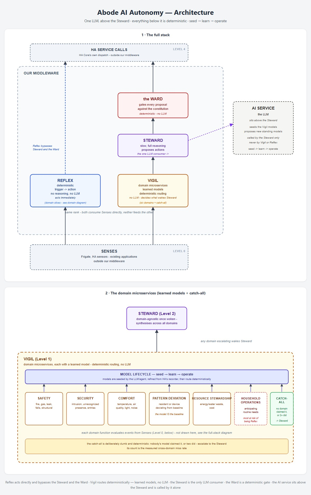
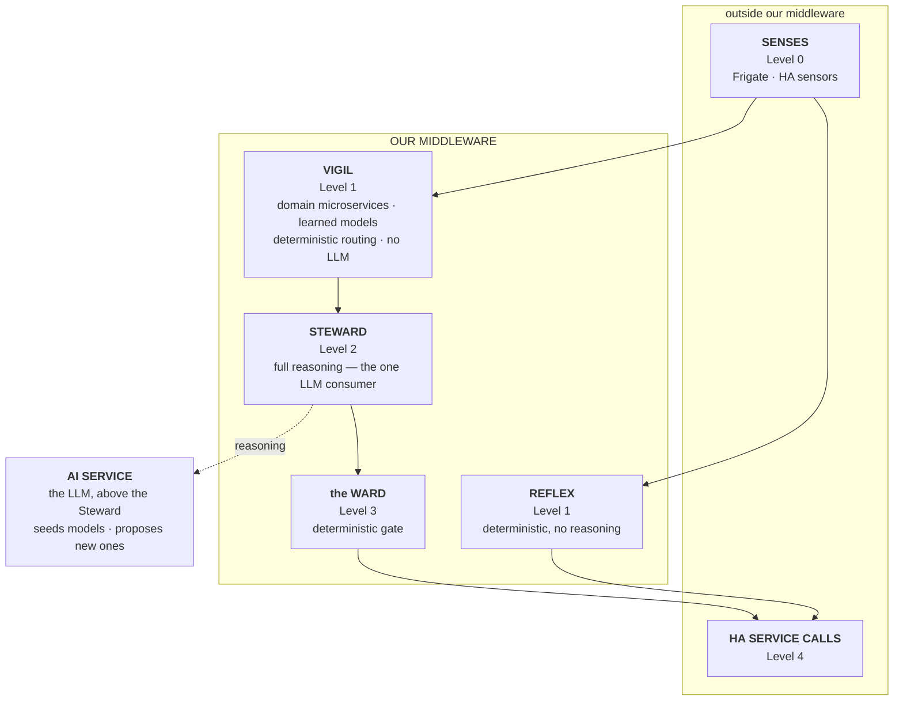
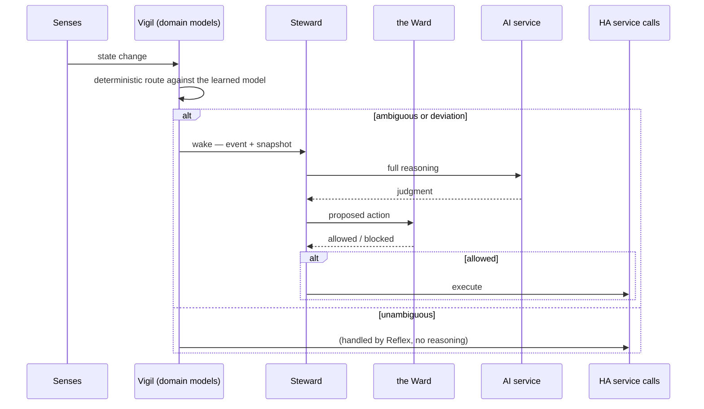
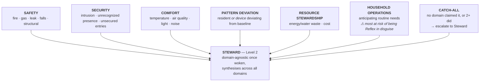

# Architecture — Abode AI Autonomy Steward

The full design specification, written for a person to read and understand in
one sitting. The numbered design rules are in [decisions](decisions/); the
original architecture theses and as-builts this is reconstructed from are in
[source/](source/).

---

## Executive summary

An autonomous home is **not a bigger rule engine**. It is a system that forms
judgment about situations it was never explicitly told how to handle — "could
it have handled a combination of circumstances nobody wrote a rule for?"

The architecture that follows from that bar has one discipline at its centre:
**there is exactly one LLM, and everything below it is deterministic.**

- **Senses** (perception) feed two independent, parallel consumers.
- **Reflex** acts on the unambiguous cases instantly, with zero reasoning.
- **Vigil** is a series of **domain microservices**, each holding a **learned
  model** of its domain, doing **deterministic routing** — "does this need
  handling, and is it Reflex or Steward?" No LLM in this path.
- **Steward** is the **one** LLM consumer — full, slow reasoning that proposes
  actions. Above it sits the **AI service** (the model itself).
- **the Ward** gates every proposal deterministically before execution.

The LLM is used to **seed** the models once, and to **propose new standing
models** rarely, through the approval protocol. After that the models learn
from data and route deterministically. **Seed → learn → operate.**

---

## The architecture at a glance

| Rank | Component | Mechanism | LLM? |
| --- | --- | --- | --- |
| 0 | **Senses** | Perception substrate (Frigate, HA sensors) | no |
| 1 | **Reflex** | Deterministic automations, zero reasoning | no |
| 1 | **Vigil** | Domain microservices — seeded, self-learning models, deterministic routing | no |
| 2 | **Steward** | Full reasoning, proposes actions | **yes — the only one** |
| — | **AI service** | The LLM, sitting above the Steward | — |
| 3 | **the Ward** | Deterministic gate on every proposal | no |
| 4 | HA service calls | Actuation, outside the middleware | no |

Reflex and Vigil sit at the **same rank** — both consume Senses directly, and
neither feeds the other. Reflex bypasses the Steward and the Ward entirely.

### Full stack

### One wake-to-action pass

---

## The six functional domains — plus a catch-all

Domains cross-cut Reflex and Vigil. Each domain has a Reflex slice (discrete,
unambiguous — no judgment) and a Vigil slice (ambiguous, context-dependent —
routed to the Steward). What varies is *ambiguity*, not subject matter.

| # | Domain | Vigil's model watches for | Notes |
| --- | --- | --- | --- |
| 1 | Safety | fire/smoke, gas, leak/flood, falls, structural | mostly Reflex already |
| 2 | Security | intrusion, unrecognized lingering presence, unsecured entries | |
| 3 | Comfort | temperature, air quality, light, noise | |
| 4 | Pattern deviation | a resident *or a device* deviating from its baseline | the model *is* the baseline |
| 5 | Resource stewardship | energy/water waste, cost | |
| 6 | Household operations | anticipating routine needs | most likely to collapse into Reflex |
| — | **Catch-all** | events no domain claimed, or 2+ did | deterministic; the cross-domain miss rate |

The **catch-all** is deliberately dumb and deterministic: if no domain's model
confidently claims an event, or two or more claim it, it escalates to the
Steward (the domain-agnostic synthesizer). The count of events it absorbs is
the measured cross-domain miss rate — a dial, not a landmine.

---

## The components, in detail

### Senses (Level 0)

Perception substrate — Frigate, HA sensors, later Tara. External and unowned,
outside the middleware boundary.

### Reflex (Level 1)

Fast, deterministic, zero reasoning. Discrete, unambiguous state transitions
with a known-correct response — a leak sensor triggering, smoke detected, a
freezer door left open. Reflex acts directly on Senses and reaches HA service
calls while bypassing the Steward and the Ward entirely.

### Vigil (Level 1) — learned domain models, deterministic routing

Vigil is **not one component and not an LLM**. It is a series of microservices,
one per domain, plus the catch-all. Each microservice holds a **learned model**
of its domain — a baseline of what is normal, fitted from HA's recorder — and
makes a **definitive** routing decision: *does this event need handling, and is
it Reflex or Steward?*

The word is **model, not rules**: the microservice's behaviour is learned from
the home's data, not hand-authored. It is deterministic when it runs, but it was
fitted, not written down. This is what makes it autonomous rather than another
automation engine — and it is also *why* it is not the "static allowlist" the
thesis warned against: Vigil decides **when** to wake the Steward, never **what**
the Steward sees. The event stream decides when; the snapshot decides what.

### The model lifecycle — seed → learn → operate

The learned models do not start empty. They are **seeded**, then **learn**, then
**operate**:

1. **Seed** — the LLM (or the setup agent, with the household reviewing)
   proposes the *initial* model per domain: "the garage is closed at night",
   "the lounge lights run 7–9am weekdays", "smoke alarms false-trigger on
   cooking". Written as priors, not left blank.
2. **Learn** — the model refines against HA's recorder and live events. The seed
   is the starting point; the data adapts it. A wrong seed gets corrected.
3. **Operate** — the learned model routes deterministically. No LLM in this path.

So the LLM's role collapses to two *offline* moments: bootstrap once, and
periodically propose a new standing model through the approval protocol (the
same gate as a new action: approve it and it runs forever; deny it and it is
buried unless the picture genuinely changes).

### Steward (Level 2)

The one LLM consumer. Slow, full reasoning over the complete state, proposes
actions. Domain-agnostic once woken — synthesis across domains is its job. Its
loop is a reactive control loop: sense fresh, decide, act or propose, repeat —
event-driven, not scheduled.

### The AI service

The LLM itself, sitting **above the Steward**. The Steward calls up to it for
judgment; nothing below the Steward does. The AI service seeds the Vigil models
at setup and proposes new standing models over time.

### the Ward (Level 3)

The constraint layer (`constraint_layer.py`). A deterministic gate that checks
every proposal — including already-approved actions — against the constitution
the charter defines. Domain-blind: it gates by service/target/type, not by which
domain proposed the action.

---

## The thesis — judgment, not lookup

The standing definition the whole architecture is checked against:

> An autonomous home is a system that forms judgment about situations it was
> never explicitly told how to handle — not one that executes more rules,
> however many, however cleverly triggered.

Two consequences that shape everything:

- **Judgment is not constant deliberation.** Continuous *awareness* (cheap,
  constant) gates *deliberate reasoning* (expensive, selective). Here the
  awareness is Vigil's learned models routing deterministically; the deliberation
  is the Steward's single LLM.
- **A static filter is not awareness.** A hand-authored allowlist is "System 1
  wearing a different hat". A *learned model* is different: it is fitted from the
  home, not pre-decided by a human, and it routes when to wake without filtering
  what is seen.

### The wake question (X1)

The Steward must wake on **derived state, not raw state**. "793.516 → 793.525"
is not a fact about the house; "solar deficit while battery is under reserve and
price is high" is — discrete, rare, and already expressible as an HA threshold
binary sensor. Threshold crossings are naturally seconds-to-minutes apart, so the
debounce completes on its own.

### Memory (Y1)

`get_states` is instantaneous; nothing in the current design carries time. The
history store already exists and is reachable over the WebSocket:
`recorder/statistics_during_period` and `history/history_during_period`. A
separate state database is rejected (duplication; `/data` is not durable; hapve
carries no intranet dependency). **What is missing is the call, not the database**
— and that call is how the Vigil models get seeded and refined.

---

## The Steward — System 2, as implemented

The `abode_ai_autonomy_steward` App is the Steward.

1. The App authenticates to HA Core over the Supervisor WebSocket and reads its
   config from `sensor.abode_ai_autonomy_steward_config`.
2. It subscribes to `state_changed`, `mobile_app_notification_action`, and the
   trigger event.
3. Any state change schedules a reasoning pass through a debounce. A
   `wake_filter` suppresses entities that fire too often — a stop-gap until the
   Vigil domain models own routing.
4. On a pass, `_reason()` gathers the state snapshot and calls the AI service
   (`ai_task.generate_data`) with the charter, the approved types, and the
   snapshot.
5. `_handle_decision()` gates the result: confidence → completeness → Ward →
   execute (approved) or propose (new).

### The decision structure

`action_needed`, `action_kind` (`new_action` / `revise_approved_type`),
`action_type`, `replaces_action_type`, `service`, `target_entity`, `service_data`,
`reasoning`, `confidence`.

### The approval protocol

Approval is per action type, not per instance. A new kind is proposed
(Approve / Deny / Never) and never acted on before approval; an approved kind
runs autonomously but is re-decided fresh each pass; a type can be retired or
replaced through the same step. Each proposal carries a single-use nonce.

### The Ward (constraint layer)

A rule blocks when the action matches every non-null field of its `match` block;
`time_range` scopes a rule to a time-of-day window, and `except` names a carve-out.
Constraints are append-only; the App refuses to start with zero rules.

### The charter

The charter is prose, shipped as `charter.md`, seeded to `/data/charter.md`, and
household-extendable. Hard prohibitions are enforced by the Ward; conditional
boundaries are honoured by the model in reasoning.

### The decision log

Every decision and its outcome is appended to an append-only
`/data/decision_log.jsonl`.

---

## Prior art that shaped this

- **ZenOS-AI scheduler** — dispatches each component only against its own
  declared `trigger_subscriptions`; priority-based load-shedding under pressure.
- **`saccade`** — Glance (cheap, "worth a closer look?") gates Focus (expensive,
  "what do I do about it?").
- **O-RAN / AV** — the fast/slow split (Near-RT vs Non-RT RIC; Perception vs
  Planning), run at their own cadence.
- **Tara Assistant** — deterministic statistical pattern detection as a cheap
  pre-filter.
- **`ai_automation_suggester`** — LLM-driven suggestions with budget-packing,
  fail-closed guardrails, and no auto-apply (human review).

---

## Open questions

- **Q16** — where the Reflex/Vigil line sits, per domain (likely uneven).
- **Q18** — the automation-authoring / model-proposal function: the LLM proposes
  new standing models and automations, gated by approval. Whether it draws on
  `ai_automation_suggester`'s methods is undecided.
- **First build** — which domain's Vigil model to build first (Safety), plus the
  catch-all, and what the measured per-event cost and catch-all rate are.

Two earlier questions are now resolved by this design: **Q13** (a second resident
model for Vigil) — *there is no second LLM model; Vigil uses learned deterministic
models* — and **Q15** (where baselines live) — *the baselines are the Vigil domain
models, seeded by the LLM and refined from HA's recorder*.

---

## Known gaps

- **Vigil is not built** — the `wake_filter` heuristic is a stop-gap, not the
  learned domain models.
- **No history wired in** (Y1) — the recorder calls exist but are not used.
- **Approvals are bound to nonces, not identities** — no per-user attribution.
- **No proposal memory** — the "deny → never again unless new evidence" loop needs
  a memory of *why* a proposal was denied.
- **The deterministic net is thin** — the Ward hard-blocks a handful of
  always-wrong actions; the conditional boundaries (content, night-visibility,
  cost-flagging, child treatment) are honoured by the model, not enforced.

---

## Quick reference

| Question | Answer |
| --- | --- |
| How many LLMs? | One — the AI service above the Steward |
| What is Vigil? | Domain microservices with learned models, deterministic routing, no LLM |
| What are the domains? | Safety, Security, Comfort, Pattern deviation, Resource stewardship, Household operations — plus a catch-all |
| What does the catch-all do? | Escalates unclaimed or multi-claimed events to the Steward |
| How do the models start? | Seeded by the LLM/agent, then learn from HA's recorder, then operate deterministically |
| What wakes the Steward? | A Vigil model routing an ambiguous or deviating event |
| Where does history live? | HA's recorder, reachable over WebSocket — no separate DB |
| What is the approval model? | Approve once per action/type, then autonomous; deny = never again unless new evidence |

## Decision history

The numbered design rules are in [decisions/](decisions/). The architecture
theses and as-builts behind the five-component model and six domains are the
`hapve-architecture-*` documents in [source/](source/).
